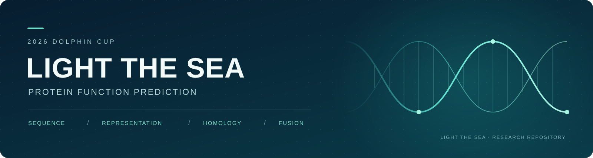
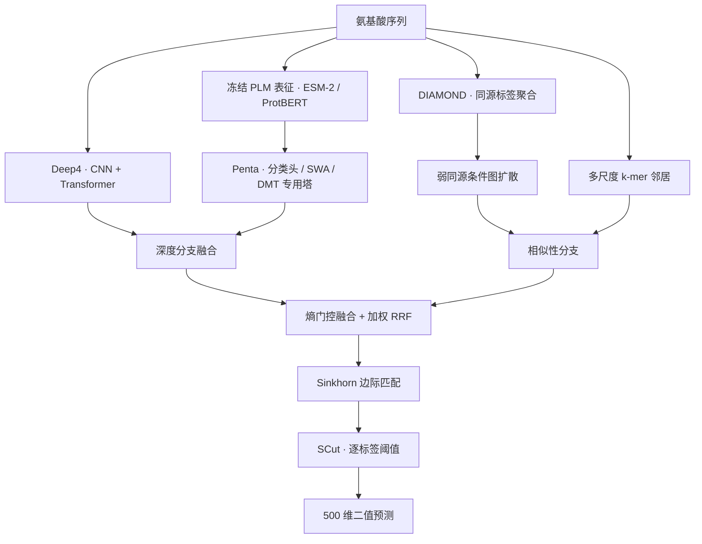

<p align="center">
  
</p>

<p align="center">
  <strong>2026 海豚杯 · 点燃大海 Light The Sea</strong><br />
  从氨基酸序列出发，融合深度表征、同源证据与最优传输，预测 500 个匿名功能标签。
</p>

<p align="center">
  
  
  
  
</p>

<p align="center">
  <a href="#项目概况">项目概况</a> ·
  <a href="#方法架构">方法架构</a> ·
  <a href="#结果与评估">结果与评估</a> ·
  <a href="#运行与复现">运行与复现</a> ·
  <a href="#文档导航">文档导航</a> ·
  <a href="#致谢">致谢</a>
</p>

---

## 项目概况

本仓库记录 **2026 海豚杯数智应用创新大赛分析赛**中，点燃大海团队的多标签蛋白质功能预测工作，包含实验代码、融合与出片流程、评估审计、研究日志及报告材料。

| 任务 | 数据规模 | 输入与输出 | 主要指标 |
| :--- | :--- | :--- | :--- |
| 多标签蛋白质功能预测 | 训练 **113,796** 条 · 测试 **28,450** 条 | 氨基酸序列 → **500 维 0/1** 标签 | **Macro F1** |

只使用竞赛提供的序列、标签和允许的预训练模型，不引入外部功能注释、GO 语义与层级、PPI 或结构标注。

> **当前状态 · 2026-10-16 整理**<br />
> 平台最佳方案为 **I130**，得分 **46.2674**、提交 AUC **0.720107**（2026-10-12 反馈）。本次整理未产生新训练成绩。最新结果以[当前研究状态](doc/当前研究状态.md)和[机器可读研究锚点](doc/current_research.json)为准。

## 方法架构

I130 将两类证据汇合：深度模型学习序列的判别表征，同源与 k-mer 分支提供相似序列的标签支持。融合后再进行标签排序、边际匹配和逐标签决策。



| 组件 | 当前方案 |
| :--- | :--- |
| **Deep4** | T001a / T002 / C002b / C005，权重 `0.12 / 0.18 / 0.42 / 0.28` |
| **PLM 分支** | ESM-2 150M、ProtBERT 和 ESM-2 650M 的冻结表征；1664D / 3840D 分类头、SWA 与 DMT 专用塔；注入权重 `0.35` |
| **同源分支** | DIAMOND top-20 / top-3 按 `0.75 / 0.25` 混合，条件图扩散 `β=0.20`；与 k-mer 等权组合 |
| **排序融合** | 相似性基础权重 `0.80`，熵门控 `γ=0.10`；加权 RRF `0.6 : 1.4`、`k=30` |
| **决策层** | Sinkhorn `τ=0.20`、融合系数 `α=0.55`；中间容量估计与最终预测均含 SCut 阶段 |

实现入口：[I130 全量出片](code/I/I130-grand-master-fulltrain-submit.py)。历史实验中的参数不一定对应当前方案，追溯时请结合[代码索引](doc/代码索引.md)。

## 结果与评估

### 平台结果

| 方案 | 平台得分 | 提交 AUC | 状态 |
| :--- | ---: | ---: | :--- |
| **I130** | **46.2674** | **0.720107** | 当前最佳 |
| I121 | 46.1881 | 0.719743 | 前一平台基准 |
| I081 | 45.9546 | 0.714590 | 历史对照 |
| C011a | 45.7665 | 0.713251 | 早期融合方案 |

I130 较 I121 得分增加 **0.0793**，提交 AUC 增加 **0.000364**。这是完整提交包的结果，不单独归因于某一组件。

### 本地评估与证据边界

| 评估协议 | I130 / Penta Macro F1 | 加入 CMAT 的 Hexa Macro F1 |
| :--- | ---: | ---: |
| 原验证集同集标定报告 | 0.45125 | 0.45118 |
| 固定模型缓存 · 两级阈值交叉拟合 | **0.44360463** | 0.44337189 |

校准外推审计同时隔离中间容量阈值与最终 SCut 的评分标签；当前 Hexa 配方较 I130 下降 `0.00023273`，5 折仅 1 折为正，因此未替换平台最佳方案。

模型和超参此前已在原验证集上选择，以上是**固定模型条件下的阈值外推**，并非全模型独立 OOF。平台得分、同集标定、阈值外推以及 PLM microAUC 各自口径不同，不直接换算或混作方法增益。详见[基线复核与校准外推](doc/日志/下一步研究计划-I130基线复核与校准外推.md)。

## 当前工作与研究方向

- **已完成**：I130 平台结果归档、提交文件身份记录、两级阈值 CPU 审计，以及历史数值与文字结论的更正。
- **已完成**：第 164 轮文献调研，四专题共 54 条登记、53 项去重核心来源；明确区分全文、正文片段、摘要和官方资源。
- **下一步**：对五个低 F1 标签开展同源可靠性诊断，检查正标签支持、近邻分歧与假阳性来源。
- **候选方案**：冻结 ESM-2 650M，追加非重叠分块以覆盖前 1022 残基之外的序列。同分类头、同评估协议进行配对比较，增益尚未验证。

训练集 **10.70%** 的序列超过 1022 残基，当前前缀截断丢失约 **14.11%** 的训练残基。长序列总体 F1 并不更低，因此覆盖缺口本身不能证明可提分。

研究依据与实施边界：[文献调研与下一步研究](doc/日志/广泛文献调研与下一步研究-I130-20261012.md)。

## 运行与复现

### 1. 获取代码

```bash
git clone https://github.com/qyyyy09315/DophinCup2026ofLtSea.git
cd DophinCup2026ofLtSea
```

### 2. 准备环境和资产

- **环境**：现有工程基于 Windows、Python 3.11 与支持 CUDA 的 PyTorch；训练主要使用 RTX 4060 8GB。仓库内 `.venv` 为本地环境，不随代码分发。
- **依赖**：主流程使用 NumPy、pandas、scikit-learn、PyTorch、Transformers、PyArrow、tqdm 等；各实验的额外依赖请结合脚本导入检查。当前尚未提供统一锁定的 Python 依赖清单。
- **数据**：将获授权的竞赛 `train.csv`、`test.csv` 放入 `data/`。标签列为 `label_0` 至 `label_499`，标识列为 `protein_id`。
- **模型与缓存**：按[代码索引](doc/代码索引.md)准备预训练模型、分类头权重、邻居索引、DIAMOND 比对及单模型概率缓存。验证集使用固定 `80/20` 切分、`random_state=42`，带标签邻居来源仅为训练折。

**这是研究代码与文档仓库。** 数据、模型权重和中间缓存不随仓库发布；全新克隆后不能直接运行最终出片脚本。下面命令面向已经具备对应本地资产的环境，须从项目根目录执行。

### 3. 运行入口

```powershell
# I130：使用既有模型、表征与邻居缓存生成提交（需要 CUDA）
.\.venv\Scripts\python.exe -u code/I/I130-grand-master-fulltrain-submit.py

# CPU 分析：固定缓存下的两级阈值交叉拟合，不生成提交
.\.venv\Scripts\python.exe -u code/tools/audit_i130_calibration.py
```

I130 输出 `submit/submission_I130_master.csv`，格式为 `protein_id` 加 500 个 0/1 标签列。已确认提交的 SHA-256：

```text
175003b786e463b8f059cca89588f302a4909c9b57f8187d43238aa1ac6b8bca
```

报告生成另使用 Node.js 与 `docx`，依赖记录于 [package.json](package.json)；报告生成脚本位于 `doc/gen_*.js`。

## 仓库结构

```text
.
├── code/                 实验、融合、推理与分析代码
│   ├── B/ C/ T/ R/       基线与序列模型
│   ├── CK/ TC/ TCK/      相似性及多模型组合
│   ├── E/ G/             预训练表征与生成式探索
│   ├── I/                集成、校准与出片流程
│   └── tools/            EDA、审计、绘图与文献工具
├── doc/                  活状态、研究记录、图表与报告
│   ├── assets/           README 视觉资产
│   ├── figures/          研究图表
│   └── 日志/             实验、文献、参考资料与待办
├── tools/diamond/        DIAMOND 工具
├── data/                 竞赛数据                 [本地，不入库]
├── models/               预训练模型和训练权重       [本地，不入库]
├── rel/                  比对、概率与分析缓存       [本地，不入库]
└── submit/               提交文件                 [本地，不入库]
```

## 文档导航

| 想了解什么 | 从这里开始 |
| :--- | :--- |
| 项目全貌与本次整理 | [项目总览 · 2026-10-16](doc/项目总览-2026-10-16.md) |
| 当前基准与研究状态 | [当前研究状态](doc/当前研究状态.md) · [JSON 锚点](doc/current_research.json) |
| 脚本、模型与产物关系 | [代码索引](doc/代码索引.md) |
| 如何阅读研究记录 | [日志入口](doc/日志/README.md) |
| 评估协议与实验约定 | [实验规则](doc/实验规则.md) · [文件规范](doc/文件规范.md) |
| 最新文献与候选设计 | [I130 广泛文献调研](doc/日志/广泛文献调研与下一步研究-I130-20261012.md) |
| 实验过程与后续任务 | [实验日志](doc/日志/实验日志.md) · [待办](doc/日志/待办.md) |
| 方法引用与参考资料 | [参考文献](doc/日志/参考文献.md) |
| 竞赛分析报告 | [报告 PDF](doc/2026海豚杯数智分析赛报告.pdf) · [Word 源稿](doc/2026海豚杯数智分析赛报告.docx) |

报告正文与部分图表形成于较早阶段，其成绩和参数须结合当前状态页解读。历史日志保留原始记录，更正以追加说明呈现。

## 团队

**点燃大海 · Light The Sea**

| 成员 | 分工 |
| :--- | :--- |
| [Yue-xin GENG](https://github.com/qyyyy09315) | 团队负责人 |
| Shu XU · Si-yang LIU · Jiao-nei WU | 团队成员 |

本项目受 **Hong-xi TAO** 邀请，作为其带领队伍的主力参加。

## 致谢
